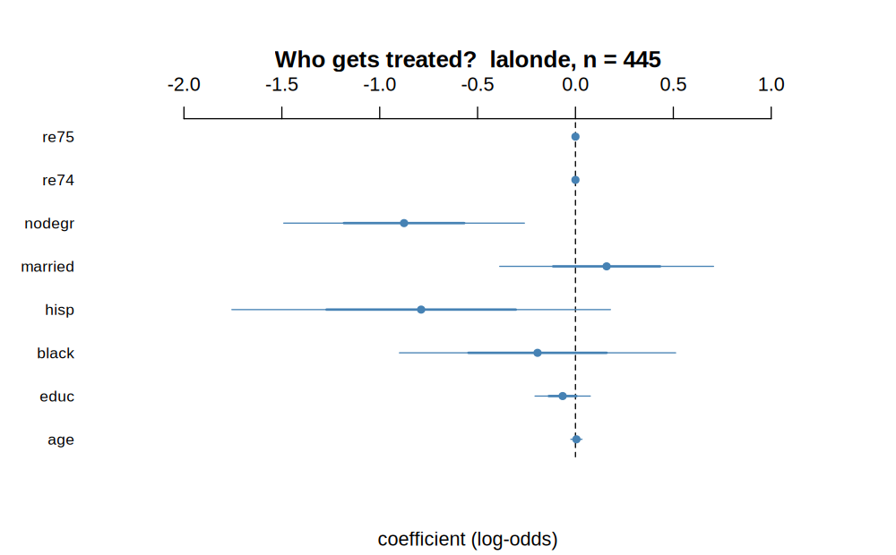
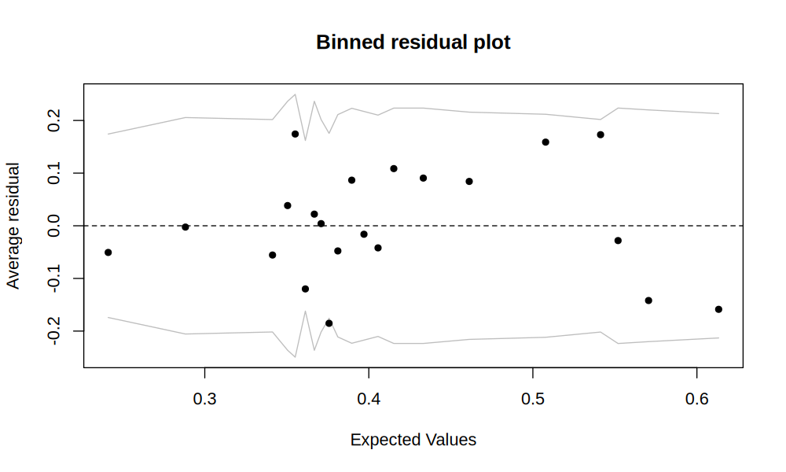

# arm

<!-- badges: start -->
[](https://CRAN.R-project.org/package=arm)
[](https://github.com/suyusung/arm/actions/workflows/R-CMD-check.yaml)
[](https://www.gnu.org/licenses/gpl-3.0.en.html)
<!-- badges: end -->

R functions to accompany *Data Analysis Using Regression and
Multilevel/Hierarchical Models* (Gelman & Hill, Cambridge University Press,
2007): Bayesian generalized linear models, simulation from fitted models,
helpers for multilevel data, and the display and diagnostic plots used
throughout the book.

## Installation

```r
install.packages("arm")                    # from CRAN

# remotes::install_github("suyusung/arm")  # development version, ahead of CRAN
```

## The pieces you are most likely to want

### `bayesglm()` — a `glm()` with weakly informative priors

`bayesglm()` takes the same arguments as `glm()` and adds weakly informative
Cauchy priors to the coefficients (`prior.df = 1`, and `prior.scale = 2.5` for a
logit link), with the predictors rescaled first so that one prior scale is
sensible for all of them. When the data are sparse or nearly separable,
maximum likelihood happily returns coefficients of ±30; the prior keeps them
somewhere you can interpret.

```r
library(arm)
data(lalonde)

m <- bayesglm(treat ~ age + educ + black + hisp + married + nodegr + re74 + re75,
              family = binomial, data = lalonde)
display(m)
#> bayesglm(formula = treat ~ age + educ + black + hisp + married +
#>     nodegr + re74 + re75, family = binomial, data = lalonde)
#>             coef.est coef.se
#> (Intercept)  1.06     1.03
#> age          0.00     0.01
#> educ        -0.07     0.07
#> black       -0.19     0.35
#> hisp        -0.79     0.48
#> married      0.16     0.27
#> nodegr      -0.88     0.31
#> re74         0.00     0.00
#> re75         0.00     0.00
#> ---
#> n = 445, k = 9
#> residual deviance = 587.2, null deviance = 604.2 (difference = 17.0)
```

### `display()` — a coefficient table you can actually read

`display()` prints the estimates with standard errors, and the fit statistics,
in the compact form the book uses. It works on `lm`, `glm`, `bayesglm`,
`polr`, `merMod` and `svyglm` objects — the output above is one call.

### `standardize()` and `rescale()` — putting inputs on a common scale

Continuous inputs are divided by two standard deviations and binary ones are
centred, so that a one-unit change means the same thing for every predictor
(Gelman 2008, *Statistics in Medicine* 27:2865–2873). The call returns a refit
model whose coefficients are named for what was done to them:

```r
names(coef(standardize(m)))
#> "(Intercept)" "z.age" "z.educ" "c.black" "c.hisp" "c.married"
#> "c.nodegr"   "z.re74" "z.re75"
```

`z.` marks a variable that was centred and divided by 2 sd, `c.` one that was
only centred. `rescale()` is the underlying transformation on a single vector.

### `sim()` — the uncertainty, not just the point estimate

`sim()` draws from the posterior of a fitted model, for `lm`, `glm`, `polr` and
`merMod` objects, and the draws come back in a form the other functions understand.

```r
sims <- sim(m, n.sims = 1000)
head(coef(sims))          # 1000 x 9 matrix of coefficient draws
```

### Plots

`coefplot()` draws estimates with one- and two-standard-error intervals — the
default way to show a regression in the book:



`binnedplot()` is the diagnostic for models with a discrete response, where a
scatterplot of residuals against fitted values is useless because everything
lands in two rows:



Also here: `corrplot()`, `discrete.histogram()`, `residual.plot()`,
`multicomp.plot()`, `triangleplot()`, `traceplot()`.

### `matching()` and `balance()` — propensity score matching

`matching()` does nearest-neighbour matching on a propensity score;
`balance()` summarises how well the matched samples line up. The package ships
`lalonde`, the dataset Dehejia and Wahba (1999) used to evaluate these methods.

## Function index

| | |
|---|---|
| Bayesian GLMs | `bayesglm()`, `bayesglm.fit()`, `bayespolr()`, `model.matrixBayes()`, `contr.bayes.ordered()`, `contr.bayes.unordered()` |
| Simulation | `sim()`, `mcsamp()`, `mcplot()`, `traceplot()`, `extractDIC()` |
| Summaries | `display()`, `se.coef()`, `se.fixef()`, `se.ranef()`, `sigma.hat()`, `binned.resids()`, `fround()`, `pfround()` |
| Plots | `coefplot()`, `binnedplot()`, `corrplot()`, `discrete.histogram()`, `residual.plot()`, `multicomp.plot()`, `triangleplot()` |
| Standardising | `standardize()`, `rescale()` |
| Matching | `matching()`, `balance()` |
| Small helpers | `invlogit()`, `logit()`, `read.columns()`, `go()` |

Each has a help page: `?display`, `?coefplot`, `?sim`.

## Links

* [CRAN page](https://CRAN.R-project.org/package=arm) and the [reference manual](https://cran.r-project.org/web/packages/arm/arm.pdf)
* Bug reports and questions — [issue tracker](https://github.com/suyusung/arm/issues)
* What changed in each release — [CHANGELOG](https://github.com/suyusung/arm/blob/master/CHANGELOG)

## License

GPL (>= 3).
